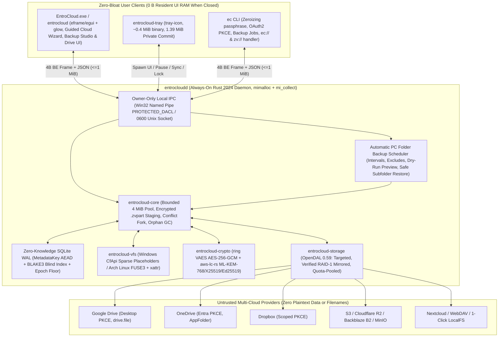

# EntroCloud v1.0 — Unified Zero-Knowledge Virtual Filesystem & Automatic Backup Architecture

## 1. Empirical Stack Decisions (Locked at Wave 1 Silicon Gate)

Every core architectural component in **EntroCloud v1.0** (merging **CloudBridge**'s guided cloud setup and automatic PC folder backup workflows with **ZeroVault**'s pure-Rust virtual filesystem and post-quantum cryptography) was selected via head-to-head hardware benchmarks on **AMD Ryzen 9 7950X3D (16C/32T) + NVIDIA GeForce RTX 4080 SUPER** (`Windows 11 x64`, `rustc 1.94.1`, MSVC `14.44.35207`) and independently verified in [VERIFICATION_LEDGER.md](VERIFICATION_LEDGER.md):

| Subsystem | Winning Technology | Measured Silicon Proof |
|---|---|---|
| **Bulk Symmetric AEAD** | **`ring 0.17.14`** (`AES-256-GCM`) | Dispatches stitched 256-bit `VAES + VPCLMULQDQ` (`ymm`) at runtime in portable baseline builds: **`11.59 GiB/s` single-thread L2**, **`39.56 GiB/s` 8T (`1 MiB`)**, **`15.61–17.72 GiB/s` 8T (`4 MiB`)** (`1.87×` faster than `aws-lc-rs` whose MSVC build strips AVX-512 GCM via `xor eax, eax; ret`; `5.89×` faster than `aes-gcm`). |
| **Post-Quantum & Asymmetric** | **`aws-lc-rs 1.19.0`** (`ML-KEM-768` + `X25519` + `Ed25519`) | Native FIPS 203 `ML-KEM-768` (`1,184 B` encaps / `1,088 B` ct) + `X25519` + `Ed25519` with C-namespaced `aws_lc_0_47_0_` symbols coexisting cleanly alongside `ring_core_0_17_14__`. |
| **Global Allocator** | **`mimalloc v0.1.52` + `libmimalloc-sys`** | Compiles cleanly on `x86_64-pc-windows-msvc` & `x86_64-unknown-linux-musl` (`tikv-jemallocator` fails `EXIT=101` on MSVC). Delivers **`35.80 GiB/s`** (`3.1×` faster than `System`, `37×` fewer page faults). Per-worker + main-thread `mi_collect(true)` on sync-idle drops `entrocloudd` physical RSS to **`5.68 MiB` (`4.27 MiB` PrivateUsage)**. |
| **Desktop UI & Tray** | **Pure Rust `eframe 0.29.1` / `egui` + `glow` + `tray-icon 0.26.1` + `AccessKit`** | **`0` WebView2/browser DLLs** and **`0` rclone subprocesses**. Single **`~5.1 MiB`** `EntroCloud.exe` / `entrocloud` binary (`7.28×` smaller than `.NET NativeAOT + Avalonia`'s `37.25 MiB` bundle), **`174.66 ms`** cold internal p50, lowest 60fps User CPU (**`437.50 ms`** over `5.0s` — `4.18×` lower than `iced+tiny-skia`), **`96.43 MiB`** 60fps RSS (`0` GC churn), **`0 B`** closed-window UI RAM, and **`8.07 MiB` RSS (`1.39 MiB` Priv)** `entrocloud-tray` helper. |

---

## 2. System Topology & Process Isolation

---

## 3. Crate Responsibilities

1. **`crates/entrocloud-types`:** Zero-I/O wire formats (`ZVH1`, `ZVC1`, `ZVM1`, `ZVK1`, `ZVS1`), KDF floor & pre-allocation DoS ceiling validators (`64..=256 MiB`), cross-OS filename sanitizer, `ec://` (and backward-compatible `zv://`) Capability URI parser, Automatic PC Folder Backup job models (`BackupJobSpec`, `BackupJobSummary`, `BackupRunReport`), IPC frames, trait contracts, and unit-test mocks.
2. **`crates/entrocloud-crypto`:** CPUID hardware enforcement (`AES-NI`/`VAES`/`PCLMULQDQ` on x86_64; `AES`/`PMULL` on ARM64), `ring` 256-bit VAES `AES-256-GCM` chunk/manifest/metadata/staging encryption, `Argon2id` + `HKDF-SHA256` 7-subkey schedule, `OsKeyringSecretStore` (`ZVS2` wrapped session), `ec://` / `zv://` capability share sealer/opener, and `keybox.zv` (`Ed25519` + `X25519` + `ML-KEM-768`).
3. **`crates/entrocloud-storage`:** OpenDAL `0.59` multi-cloud operators, hardened OAuth2 S256 PKCE loopback (`5s` per-socket timeout, probe-resilient listener, `drive.file` & `AppFolder` least-privilege scopes), `Targeted` / `Mirrored` (fastest-read with cryptographic bit-rot failover) / `QuotaPooled` (`AtomicU64` CAS spillover), HTTP `Range` slice reads, and `ChaosStorageRouter` packet-failure injector.
4. **`crates/entrocloud-vfs`:** Native Windows Cloud Files API (`cloud-filter` 4 KiB-aligned `<= 4 MiB` progressive range hydration + `unpin -> dehydrate` space reclamation) and Arch Linux `fuser v0.18` (`SessionACL::Owner`, `Zeroizing` `DirtyWriteBuffer`, `user.entrocloud.{state,pin,file_id}` + legacy `user.zerovault.*` xattrs).
5. **`crates/entrocloud-core`:** Zero-knowledge SQLite WAL (`enc_name` + `BLAKE3` `name_blind_idx`, `PRAGMA secure_delete = ON`, monotonic `security_epochs`), deadlock-safe `BoundedBufferPool` (full `0..capacity` zeroization + `mi_collect(true)` idle reclamation), AEAD-encrypted `.zvpart` local dirty staging, `.partial` atomic file export promotion, non-destructive conflict preservation, and orphan `.zv` blob GC.
6. **`crates/entrocloud-daemon` (`entrocloudd`):** Owner-ACL Named Pipe (`D:P(A;;GA;;;SY)(A;;GA;;;OW)`) & `0600` Unix Domain Socket server, multi-device `vault/header.zvh` cloud bootstrap (`publish_vault_header` / `fetch_vault_header`), automatic PC folder backup job scheduler (scheduled intervals, glob excludes, dry-run preview, non-destructive subfolder restore, pause/cancel), remote connectivity probes (`TestRemote`), 1-click synced cloud folder detection (`DetectLocalClouds`), and live transfer telemetry.
7. **`crates/entrocloud-cli` (`ec`):** Full administrative, sharing (`ec://` / `zv://` & `keybox`), OAuth2 PKCE, remote management, and silicon benchmark CLI with `Zeroizing` secret handling.
8. **`crates/entrocloud-ui` (`entrocloud` / `EntroCloud.exe` & `entrocloud-tray`):** Pure Rust `eframe`/`egui` (`glow`) desktop studio featuring the Guided Cloud Setup Wizard, Automatic Folder Backup Studio, Virtual Drive Explorer, and Sharing & Keybox manager + `tray-icon` helper (`0` WebView2 processes; `0 B` resident UI surface RAM when window closed) + OS `ec://` and `zv://` URI protocol handler.
