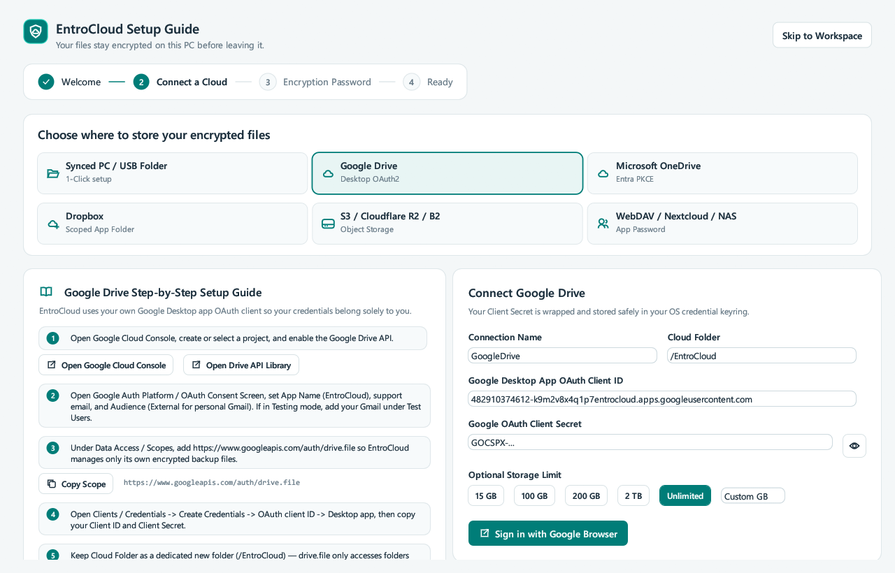
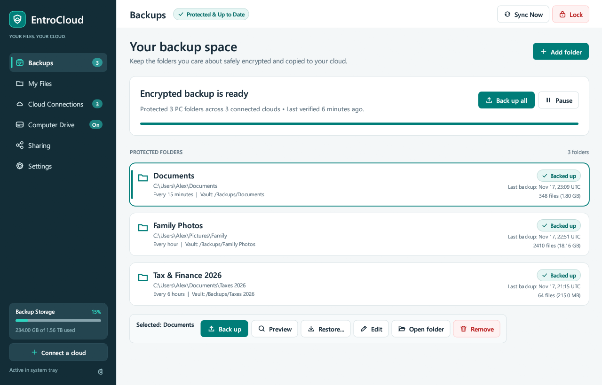
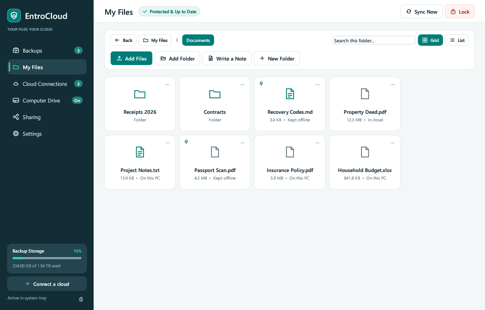
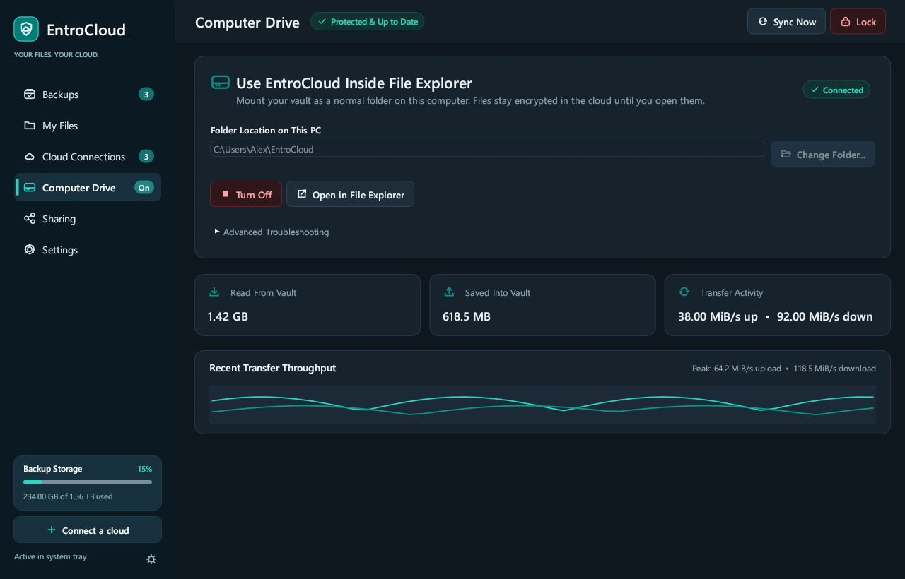
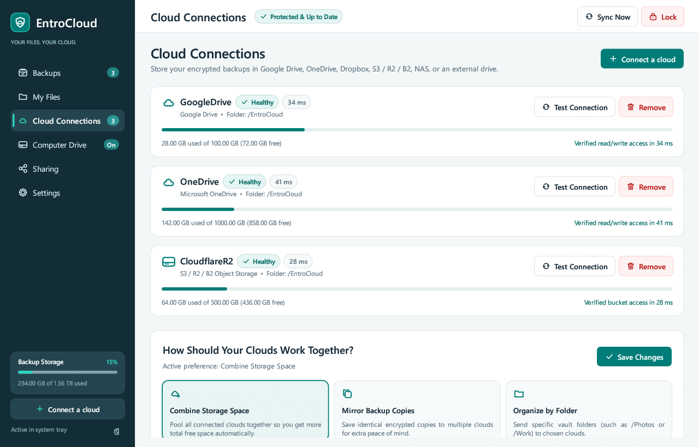
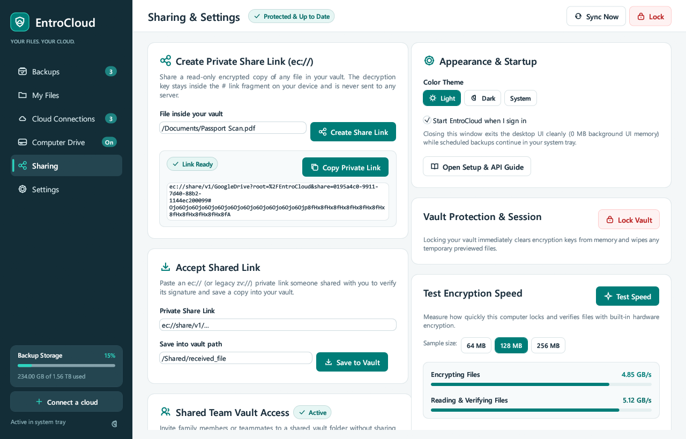

# EntroCloud v1.0 (`cloud.entropy.rs`)

**Zero-knowledge multi-cloud virtual filesystem, automatic PC folder backup suite, post-quantum folder sharing engine, and zero-WebView native desktop studio** written in pure Rust (`edition = "2024"`, `rustc >= 1.90`).

EntroCloud unifies **CloudBridge's** effortless automatic PC folder backup workflows, guided cloud setup wizard, dry-run previews, and safe subfolder restores with **ZeroVault's** silicon-accelerated on-demand virtual drive (**Windows 10/11 Cloud Files API (`CfApi`)** and **Arch Linux `FUSE3` (`fuser v0.18`)**), pooling or mirroring ciphertext across **Google Drive, Microsoft OneDrive, Dropbox, Amazon S3 / Cloudflare R2 / Backblaze B2 / MinIO, Nextcloud / WebDAV, and Local / Synced Cloud Folders** (`opendal 0.59`) without ever exposing plaintext bytes, filenames, directory trees, or sharing keys to remote providers or unencrypted local disk pages.

- **Guided Cloud Provider Setup:** [`GOOGLE-DRIVE-SETUP.md`](GOOGLE-DRIVE-SETUP.md)
- **Architecture & Topology:** [`ARCHITECTURE.md`](ARCHITECTURE.md)
- **Cryptographic & Wire Specification:** [`SPEC_CRYPTO.md`](SPEC_CRYPTO.md)
- **Adversarial Silicon & Security Ledger:** [`VERIFICATION_LEDGER.md`](VERIFICATION_LEDGER.md)

---

## Desktop GUI Tour (`EntroCloud` — Light & Dark Themes, Zero WebView2)

| Guided Setup & Google Drive API Wizard | Automatic PC Folder Backups (Light & Dark) |
| :---: | :---: |
|  |  |
| **Vault File Manager (Grid & List Views)** | **Virtual Computer Drive & Live Throughput** |
|  |  |
| **Multi-Cloud Health & Storage Pooling** | **Private `ec://` Share Links & Settings** |
|  |  |

---

## 1. Empirically Verified Silicon Telemetry

All stack components were locked via head-to-head hardware benchmarks on **AMD Ryzen 9 7950X3D (`16C/32T`) + NVIDIA GeForce RTX 4080 SUPER** (`Windows 11 x64`, `rustc 1.94.1`, MSVC `14.44.35207`) and independently verified in [`VERIFICATION_LEDGER.md`](VERIFICATION_LEDGER.md):

| Subsystem | Locked Implementation | Verified Hardware Measurement |
| :--- | :--- | :--- |
| **Bulk Symmetric AEAD** | **`ring 0.17.14`** (`AES-256-GCM`) | Runtime CPUID-dispatched stitched 256-bit `ymm` `VAES + VPCLMULQDQ`: **`11.59 GiB/s` (`0.337 cpb`) 1T L2**, **`39.56 GiB/s` (`50.55 ms` / `2 GiB`) 8T (`1 MiB`)**, **`15.47–16.22 GiB/s` 8T (`4 MiB`)** (`1.91×` faster than `aws-lc-rs` 128-bit `xmm` on MSVC; `6.04×` faster than `aes-gcm`). |
| **Post-Quantum & Signatures** | **`aws-lc-rs 1.19.0`** | Native NIST FIPS 203 **`ML-KEM-768`** (`1,184 B` encaps / `1,088 B` ciphertext) + **`X25519`** + **`Ed25519`** (`aws_lc_0_47_0_` C-namespaced alongside `ring_core_0_17_14__`). |
| **Global Allocator & Idle RSS** | **`mimalloc v0.1.52`** + `libmimalloc-sys` | **`35.80 GiB/s`** streaming throughput (`3.0×` faster than Windows `System`, `37×` fewer soft page faults), bounded **`<= 128 MiB`** Peak RSS, and per-worker `mi_collect(true)` idle reclamation dropping `entrocloudd` physical RSS to **`5.68 MiB` (`4.27–4.30 MiB` Private Commit)**. |
| **Zero-WebView Native UI** | **`eframe 0.29.1` / `egui`** (`glow`) + `AccessKit` | **`0` WebView2 / browser DLLs**, **`~5.1 MiB`** standalone `EntroCloud.exe` / `entrocloud` binary (`7.28×` smaller than `.NET NativeAOT + Avalonia`), **`174.66 ms`** cold internal TTI `p50`, **`437.50 ms`** User CPU over `5.0 s` @ `60 fps` (`0.576 ms/frame`), **`96.43 MiB`** active 60fps RSS (`0` GC churn), and **`0 B` closed-window UI RAM**. |
| **System Tray Helper** | **`tray-icon 0.26.1`** (`entrocloud-tray`) | **`~0.4 MiB`** binary, **`8.07 MiB` RSS (`1.39 MiB` Private Commit)**, spawns `EntroCloud.exe` / `entrocloud` on demand over local IPC. |

---

## 2. Core Capabilities

1. **Guided Multi-Cloud Onboarding & Connectivity Probes:**
   - Interactive browser **OAuth2 + S256 PKCE** loopback sign-in (`127.0.0.1`, `5s` slowloris-hardened per-socket deadlines, least-privilege `drive.file` / `AppFolder` scopes) for **Google Drive**, **Microsoft OneDrive**, and **Dropbox**, plus **Cloudflare R2 / Amazon S3 / Backblaze B2 / MinIO**, **Nextcloud / WebDAV**, and **1-Click Auto-Detected Local / Synced Cloud Folders**.
   - Built-in **Test Connection** latency and quota probe (`TestRemote`) and **Cancel Sign-In** (`CancelOAuth`) flow; step-by-step walkthrough in [`GOOGLE-DRIVE-SETUP.md`](GOOGLE-DRIVE-SETUP.md).
2. **Automatic PC Folder Backup Jobs (CloudBridge Heritage):**
   - Schedule local PC folders (e.g., `Documents` -> `/Backups/Documents` every 15 minutes) with configurable glob exclusions (`desktop.ini`, `Thumbs.db`, `~$*`, `node_modules`).
   - Run **Dry-Run Preview** (`0` cloud writes) before uploading, **Pause / Resume / Cancel** background runs at any time, and perform **Safe Non-Destructive Restore** into a fresh destination subfolder after cryptographic verification.
3. **On-Demand Encrypted Virtual Drive (ZeroVault Heritage):**
   - Mounts a native **Windows 10/11 Explorer Cloud Files (`CfApi`)** sync root or **Arch Linux `FUSE3`** virtual drive (`fuser v0.18` with `SessionACL::Owner` and `user.entrocloud.{state,pin,file_id}` + legacy `user.zerovault.*` extended attributes) with progressive `4 KiB`-aligned hydration and instant space reclamation (`unpin` + `dehydrate`).
4. **Zero-Knowledge Security & Tamper-Evident Storage:**
   - Remote storage sees **only** whitelisted opaque keys (`vault/header.zvh`, `vault/keybox.zv`, `manifests/head.zvm`, `manifests/<aa>/<bb>/<uuid>.zvm`, `shares/<aa>/<bb>/<uuid>.zvs`, `blobs/<aa>/<bb>/<uuid>.zv`).
   - Local SQLite WAL encrypts all entry names, dirty-op payloads, and conflict records under `MetadataKey` (`AES-256-GCM`) with keyed `BLAKE3` blind indexes (`BlindIndexKey`), `PRAGMA secure_delete = ON`, monotonic anti-rollback `security_epochs`, and AEAD-encrypted `.zvpart` local dirty staging wiped on `LockVault`.
   - Pre-allocation `Argon2id` bounds (`64 MiB <= m <= 256 MiB`, `3 <= t <= 10`, `4 <= p <= 16`) block weak KDF headers and OOM DoS headers *before* allocating memory.

---

## 3. Workspace Layout & Native Binaries

| Crate | Binary Target(s) | Responsibility |
| :--- | :--- | :--- |
| `crates/entrocloud-types` | *(lib)* | Wire codecs (`ZVH1`, `ZVC1`, `ZVM1`, `ZVK1`, `ZVS1`), `ec://` + `zv://` URI parser, backup job & IPC models, KDF validators, traits |
| `crates/entrocloud-crypto` | *(lib)* | CPUID gate, `ring` VAES `AES-256-GCM`, `Argon2id` + `HKDF-SHA256`, `aws-lc-rs` `ML-KEM-768`/`X25519`/`Ed25519`, `OsKeyringSecretStore` |
| `crates/entrocloud-storage` | *(lib)* | OpenDAL `0.59` connectors, hardened S256 PKCE loopback OAuth2, `Targeted`/`Mirrored`/`QuotaPooled` router, `ChaosStorageRouter` |
| `crates/entrocloud-vfs` | *(lib)* | Windows `CfApi` (`cloud-filter` progressive 4 KiB-aligned hydration) & Arch Linux `fuser v0.18` (`SessionACL::Owner` + `xattr`s) |
| `crates/entrocloud-core` | *(lib)* | Zero-knowledge SQLite WAL, `BoundedBufferPool` + `mi_collect(true)`, encrypted `.zvpart` staging, conflict fork, orphan `.zv` GC |
| `crates/entrocloud-daemon` | `entrocloudd` | Always-on sync, automatic folder backup scheduler & VFS daemon, `vault/header.zvh` cloud bootstrap, owner-ACL IPC server |
| `crates/entrocloud-cli` | `ec` | Full vault, OAuth2, backup job, multi-cloud routing, VFS, `ec://` + `zv://` share, `keybox.zv`, conflict, and benchmark CLI |
| `crates/entrocloud-ui` | `entrocloud` (`EntroCloud.exe`), `entrocloud-tray` | Pure Rust `eframe/egui` (`glow`) desktop studio (`0 B` closed RAM), guided cloud wizard, backup studio, `tray-icon` helper, `ec://` + `zv://` handler |
| `tests/e2e` | *(integration)* | Multi-cloud zero-knowledge, `TerminateProcess` crash recovery, `30%` network chaos, post-quantum sharing, and red-team tamper suites |

---

## 4. Quickstart (`EntroCloud.exe` Desktop Studio & `ec` CLI)

### Launch the Zero-WebView Desktop Studio
```bash
# Windows (double-click EntroCloud.exe in Explorer or run from PowerShell):
.\EntroCloud.exe

# Arch Linux:
entrocloud
```
`EntroCloud.exe` (`entrocloud` on Linux) connects to `entrocloudd` over owner-only local IPC (automatically starting `entrocloudd` if not yet running). Closing the window exits the UI process completely (`0 B` background UI RAM) while `entrocloudd` and optional `entrocloud-tray` remain active in the background.

### `ec` CLI Workflow

1. **Start `entrocloudd` and initialize (or unlock on a second PC) a vault:**
   ```bash
   # Start daemon in background (or via systemd --user / EntroCloud.exe autostart)
   entrocloudd &

   # Initialize a brand-new vault (publishes vault/header.zvh once remotes are attached)
   ec init

   # On a second PC: attach your cloud remote first, then unlock (fetches vault/header.zvh automatically)
   ec unlock
   ```

2. **Connect Cloud Storage Accounts (see [`GOOGLE-DRIVE-SETUP.md`](GOOGLE-DRIVE-SETUP.md)):**
   ```bash
   # Interactive browser OAuth2 + S256 PKCE loopback login (Google Drive least-privilege drive.file scope)
   printf '%s\n' "$GDRIVE_CLIENT_SECRET" | ec remote oauth gdrive-main \
     --kind gdrive --root /EntroCloud --client-id "$GDRIVE_CLIENT_ID" \
     --client-secret-stdin --policy pooled --quota-mib 15360

   # S3 / Cloudflare R2 / Backblaze B2 / MinIO bucket (secret read safely from stdin into OS keyring)
   printf '%s\n' "$R2_SECRET_KEY" | ec remote add r2-primary \
     --kind s3 --bucket my-entrocloud --region auto \
     --endpoint "https://<account>.r2.cloudflarestorage.com" \
     --root /vault --username "$R2_ACCESS_KEY" --secret-stdin --policy pooled --quota-mib 51200

   # 1-Click local / synced cloud folder (OneDrive, Google Drive, Dropbox, iCloud, NAS)
   ec remote detect-clouds
   ec remote add local-nas --kind fs --root /mnt/nas/EntroCloudVault --policy mirrored
   ```

3. **Mount On-Demand Virtual Drive (`CfApi` / `FUSE3`) & Manage Space:**
   ```bash
   # Windows 10/11: registers native Explorer Cloud Files sync root
   ec mount "$HOME/EntroCloud"

   # Pin offline (hydrates all 4 MiB chunks) & later free local disk space (unpins -> dehydrates)
   ec pin /Finance/2026-Audit.pdf
   ec unpin /Finance/2026-Audit.pdf
   ec dehydrate /Finance/2026-Audit.pdf

   # Arch Linux FUSE3 xattr inspection & offline pinning (legacy user.zerovault.* also supported):
   getfattr -n user.entrocloud.state ~/EntroCloud/Finance/2026-Audit.pdf
   setfattr -n user.entrocloud.pin -v "1" ~/EntroCloud/Finance/2026-Audit.pdf
   setfattr -n user.entrocloud.pin -v "0" ~/EntroCloud/Finance/2026-Audit.pdf
   ```

4. **Check Telemetry, Benchmark Silicon, or Lock Immediately:**
   ```bash
   ec status
   ec bench-crypto --mib 128
   ec lock   # Wipes keys, purges caches/.zvpart staging, unmounts VFS, and runs mi_collect(true)
   ```

---

## 5. Multi-Cloud Routing Modes

EntroCloud's `StorageRouter` decouples logical vault files and folder backups from physical cloud accounts and supports live policy switching:

| Policy Mode | Behavior & Fault-Tolerance Guarantees |
| :--- | :--- |
| **`QuotaPooled` (`pooled`)** | Aggregates storage across multiple accounts (e.g. combining free-tier Google Drive + OneDrive + Dropbox + R2). Uses lock-free `AtomicU64` CAS quota reservation before upload and seamlessly spills `4 MiB` chunks across providers when an account fills up. |
| **`Mirrored` (`mirrored`)** | **Cryptographically Verified RAID-1:** Writes chunks concurrently across mirrors (`min_ack` quorum) with composite manifest CAS. Reads race healthy mirrors via `select_ok` for lowest latency and **automatically fail over to healthy mirrors if the fastest responder returns bit-rotted or tampered bytes (`HTTP 200` AEAD failure)**. |
| **`Targeted` (`targeted`)** | Routes files by longest virtual-path prefix (e.g., `/Backups/Compliance` -> `s3-eu-central`, `/Archive` -> `b2-cold`, default -> `gdrive-main`). Routing evaluation happens strictly inside the local client; remote object keys remain opaque UUIDs. |

---

## 6. Serverless Zero-Knowledge Sharing (`ec://`, `zv://` & Post-Quantum `keybox.zv`)

### 6.1 1-Click Read-Only Capability URIs (`ec://` + Legacy `zv://`)
Share individual files through untrusted cloud storage with zero server-side access control lists:
```text
ec://share/v1/<backend_hint>?root=<url_encoded_root>&share=<share_uuid>#<base64url_nopad(SRK_32B || Ed25519_PubKey_32B)>
```
- **Client-Only Secret Fragment (`RFC 3986 §3.5`):** The `#<64B>` fragment carrying the 256-bit `ShareRootKey` (`SRK`) and owner's `32 B` `Ed25519` public key is never sent over HTTP or logged by cloud servers.
- **Signature-Before-Decrypt & Dual-Scheme Compatibility:** Recipients verify the 64-byte `Ed25519` signature on `shares/<aa>/<bb>/<share_uuid>.zvs` (`ZVS1`) against the pinned URI public key before unwrapping the file DEK. Both primary `ec://` and legacy `zv://` links open seamlessly in `EntroCloud.exe` / `entrocloud` and `ec`.

```bash
# Generate a signed read-only ec:// capability link
ec share create-uri /Research/paper.pdf

# Import via CLI — or click any ec:// or zv:// link on Windows / Arch Linux to open directly in EntroCloud!
ec share import-uri "ec://share/v1/s3?root=%2Fvault&share=..." /Shared/paper.pdf
```

### 6.2 Revocable Multi-Recipient Post-Quantum Keyboxes (`vault/keybox.zv` — `ZVK1`)
Collaborate on shared vaults with post-quantum confidentiality and cryptographic revocation:
- **Hybrid `X25519 + ML-KEM-768` Encapsulation:** Each authorized recipient's stanza combines ephemeral `X25519` ECDH with NIST FIPS 203 **`ML-KEM-768`** (`aws-lc-rs`) via domain-separated `HKDF-SHA256` to wrap the 256-bit `FolderRootKey` (`FRK`), signed end-to-end by the owner's `Ed25519` key.
- **Epoch Rotation & Anti-Replay:** Revoking a recipient increments `epoch = prev_epoch + 1`, rotates a fresh CSPRNG `FRK'`, re-encapsulates `FRK'` exclusively for remaining recipients, and advances SQLite `security_epochs.min_epoch` so replaying historical `keybox.zv` epochs fails closed (`CryptoTamperDetected`).

```bash
# Recipient exports their public hybrid identity bundle (Ed25519 + X25519 + ML-KEM-768)
ec share id --label "alice@workstation"

# Vault owner initializes keybox.zv, grants Alice, inspects epoch, and later revokes access
ec share keybox-init
ec share keybox-grant "<alice_base64url_bundle>"
ec share keybox-status
ec share keybox-revoke "<alice_32hex_recipient_id>"
```

---

## 7. Installation & OS Packaging

### Windows 10/11 (`packaging/windows/`)

**Prerequisites (Build from Source):** Rust `>= 1.90` (`x86_64-pc-windows-msvc`), Visual Studio 2022 C++ Build Tools, CMake, and Windows 10/11 SDK (`aws-lc-rs` uses `prebuilt-nasm`, so `nasm.exe` is not required).

1. **Build & Verify Zero-WebView Portable `.zip`:**
   ```powershell
   powershell -ExecutionPolicy Bypass -File .\packaging\windows\bundle-portable.ps1
   ```
   Builds `-p entrocloud-daemon -p entrocloud-cli -p entrocloud-ui`, audits all 4 PE binaries (`EntroCloud.exe`, `entrocloudd.exe`, `ec.exe`, `entrocloud-tray.exe`) via `dumpbin.exe /dependents` and raw ASCII/UTF-16LE string scanning (`0` WebView2 / browser DLLs or static loaders), stages `dist\windows\entrocloud-portable` (including `GOOGLE-DRIVE-SETUP.md`, `README-WINDOWS.txt`, and `SHA256SUMS.txt`), and produces `dist\windows\entrocloud-windows-x86_64-portable.zip`.

2. **User-Local Install (No UAC / Admin Required):**
   ```powershell
   powershell -ExecutionPolicy Bypass -File .\packaging\windows\install.ps1
   # Optional: also enable HKCU:\Software\Microsoft\Windows\CurrentVersion\Run "EntroCloud"
   powershell -ExecutionPolicy Bypass -File .\packaging\windows\install.ps1 -EnableAutoStart
   ```
   Installs `EntroCloud.exe`, `entrocloudd.exe`, `ec.exe`, `entrocloud-tray.exe`, and `GOOGLE-DRIVE-SETUP.md` to `%LOCALAPPDATA%\Programs\EntroCloud`, updates User `PATH`, creates Start Menu and Desktop shortcuts for `EntroCloud.exe`, and registers both `HKCU:\Software\Classes\ec` and `HKCU:\Software\Classes\zv`.

3. **Standalone `ec://` + `zv://` URI Handler Registration / Removal (Idempotent, Zero UAC):**
   ```powershell
   powershell -ExecutionPolicy Bypass -File .\packaging\windows\register-uri.ps1
   powershell -ExecutionPolicy Bypass -File .\packaging\windows\unregister-uri.ps1
   ```

4. **Per-User MSI Installer (WiX Toolset v4):**
   ```powershell
   wix build .\packaging\windows\entrocloud.wxs -d BinSourceDir=.\target\release -o .\dist\windows\EntroCloud-1.0.0-x64.msi
   ```

### Arch Linux (`packaging/arch/`)

**Zero `webkit2gtk` / Tauri / browser dependencies** (`depends=('fuse3' 'gcc-libs' 'glibc' 'libsecret' 'libglvnd' 'wayland' 'libxkbcommon')`, `makedepends=('cargo' 'cmake')`).

```bash
# Build and install /usr/bin/{entrocloudd,ec,entrocloud,entrocloud-tray}, systemd user units & .desktop entry
cd packaging/arch
makepkg -si

# Register 1-click ec:// (and legacy zv://) capability share protocol handlers via XDG MIME
xdg-mime default entrocloud.desktop x-scheme-handler/ec
xdg-mime default entrocloud.desktop x-scheme-handler/zv

# Enable hardened user daemon (ProtectSystem=strict, ProtectHome=read-only + scoped ReadWritePaths) & optional tray
mkdir -p ~/.local/share/entrocloud ~/.config/entrocloud ~/EntroCloud
systemctl --user daemon-reload
systemctl --user enable --now entrocloudd.service
systemctl --user enable --now entrocloud-tray.service
```

---

## 8. Developer Build, Lint & Verification Commands

```bash
# Build release binaries
cargo build --release --locked -p entrocloud-daemon -p entrocloud-cli -p entrocloud-ui

# Strict zero-warning Clippy gate (host + Linux musl cross-target VFS verification)
cargo clippy --workspace --all-targets --locked -- -D warnings
cargo clippy -p entrocloud-vfs --all-targets --locked --target x86_64-unknown-linux-musl -- -D warnings

# Run full unit, property-based (proptest), and E2E zero-knowledge security suites
cargo test --workspace --locked
```

---

## License

Dual-licensed under `MIT OR Apache-2.0`.
